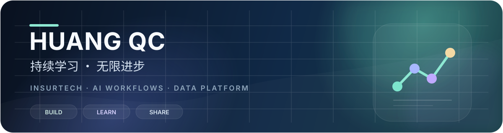

  

## 你好，我是 huangqc

我专注于把复杂业务变成可靠、清晰、可持续演进的软件系统，关注保险科技、AI 研发工作流与数据平台。

- **保险科技**：从业务建模、接口集成到生产交付的完整工程链路
- **AI 应用**：AI Agent、研发自动化与可复用工作流
- **数据平台**：事件驱动、数据同步与业务数据治理
- **全栈研发**：Java / Spring Boot、Vue 3 / TypeScript、MySQL、Redis、Docker

## 技术栈

`Java` · `Spring Boot` · `Vue 3` · `TypeScript` · `MySQL` · `Redis` · `Docker` · `AI Agent`

## 精选项目

### [ai-coding-work-flow](https://github.com/BigHuang8/ai-coding-work-flow)

面向 AI 辅助研发的工程化工作流，沉淀可复用的协作方式、技能与自动化实践。

## 正在持续探索

- 让 AI 更可靠地参与真实软件交付
- 用事件驱动连接业务系统与数据平台
- 打磨可维护、可观测、可交付的企业级应用

> 持续学习，无限进步。
